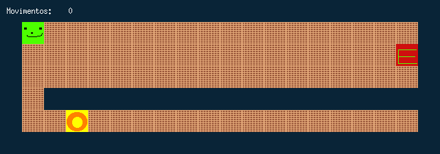

# so_long


> A small top-down 2D game in C: collect everything, then reach the exit — on a map the program refuses to load unless it can prove the level is winnable.



*`map.ber` at the start: the player top-left, the collectible bottom-left, the exit — still closed — on the right.*

The player walks around a tile map, picks up every collectible, and leaves through the exit, which only opens once the last item is taken. The game reads its level from a `.ber` text file, draws it with MiniLibX — 42's thin layer over X11, which gives a window, images and keyboard events and nothing else — and counts every move.

The game loop is the easy part. Most of the code is in the loader, because the map comes from a file anyone can edit. Before a window ever opens, the map has to be rectangular, closed by walls, made only of known characters, with exactly one start and one exit, at least one collectible — and every collectible and the exit must actually be reachable from the start.

---

## Table of contents

- [Usage](#usage)
- [Building](#building)
- [Map format](#map-format)
- [Architecture](#architecture)
- [Proving the map is winnable](#proving-the-map-is-winnable)
- [Drawing only what changed](#drawing-only-what-changed)
- [Design notes](#design-notes)
- [Edge cases handled](#edge-cases-handled)
- [Revisiting it](#revisiting-it)
- [What I took away from it](#what-i-took-away-from-it)

---

## Usage

```bash
./so_long map.ber
```

| Key | Action |
| --- | --- |
| `W` `A` `S` `D` | Move up, left, down, right |
| `ESC` | Quit |
| Window close button | Quit |

Each move is printed to the terminal and shown in the top-left corner of the window. Walking into a wall, or into the exit before it opens, does nothing and does not count as a move. The sprites are loaded from `sprites/`, so run the game from the repository root.

## Building

MiniLibX is bundled in `mlx-linux/` and built by the Makefile. It needs the X11 development headers:

```bash
sudo apt install libx11-dev libxext-dev zlib1g-dev   # Debian / Ubuntu
```

```bash
make        # builds libft, MiniLibX, then ./so_long
make clean  # removes the object files, including libft's
make fclean # also removes the binary and libft.a
make re     # fclean + all
```

Compiled with `-Wall -Wextra -Werror`. `libft` is my own C library from the first project, including `get_next_line`, which reads the map.

## Map format

A `.ber` file is a grid of characters, one row per line:

| Character | Tile |
| --- | --- |
| `1` | Wall |
| `0` | Floor |
| `P` | Player start |
| `C` | Collectible |
| `E` | Exit |

```
11111111111111111111
1P000000000000000001
100000000000000000E1
10000000000000000001
10111111111111111111
100C0000000000000001
11111111111111111111
```

The exit is in reach from the first move, but it stays closed until the player goes down through the gap in the inner wall, picks up the collectible and comes back.

## Architecture

```
main
 ├─ check_name            the file name must end in .ber
 ├─ read_map              pass 1: measure the first row, count the rows
 │   └─ build_matrix      pass 2: one get_next_line string per row
 │       ├─ check_rectangular    every row has the same width
 │       ├─ check_walls          first/last row and column are all '1'
 │       └─ check_letters
 │           ├─ check_conditions     1 P, 1 E, ≥ 1 C, no other characters
 │           ├─ find_tile            locate P and E
 │           └─ check_path_player_to flood fill on a copy of the map
 ├─ mlx_init / create_window     refuse maps larger than the screen
 ├─ store_sprites         load the six 32×32 XPM tiles once
 ├─ draw_map              paint the whole window
 ├─ hooks                 key ─▶ move_player    expose ─▶ draw_map    close ─▶ quit
 ├─ mlx_loop
 └─ cleanup               sprites, window, display, map
```

All state lives in one `t_data` struct passed to every function and to the MiniLibX hooks: the MiniLibX handles, the map (`t_map`, with the exit's position), the player's position, collectibles left and moves (`t_player`), and the loaded images (`t_imgs`).

The map is a `char **` — the same array the loader validated is the game state. A move rewrites two cells: the old position becomes `0`, the new one `P`.

## Proving the map is winnable

`check_path_player_to` copies the map and runs a flood fill from the player's start. It is iterative, with an explicit stack, so the depth does not grow with the size of the map:

```c
static void	push_cell(t_flood_fill *fill, int x, int y)
{
	char	*cell;

	if (x < 0 || x >= fill->columns || y < 0 || y >= fill->rows)
		return ;
	cell = &fill->matrix_copy[y][x];
	if (*cell == '1' || *cell == 'V')
		return ;
	if (*cell == 'E')
		fill->found_exit = 1;
	if (*cell == 'C')
		fill->collectibles--;
	if (*cell != 'E')
		fill->stack[fill->top++] = y * fill->columns + x;
	*cell = 'V';
}

void	flood_fill(t_flood_fill *fill, int x, int y)
{
	int	pos;

	push_cell(fill, x, y);
	while (fill->top > 0)
	{
		pos = fill->stack[--fill->top];
		x = pos % fill->columns;
		y = pos / fill->columns;
		push_cell(fill, x - 1, y);
		push_cell(fill, x + 1, y);
		push_cell(fill, x, y - 1);
		push_cell(fill, x, y + 1);
	}
}
```

A cell is marked as visited (`V`) when it is pushed, so each cell enters the stack at most once and `rows × columns` entries are always enough. The map is accepted only if the fill reaches the exit **and** the collectible counter reaches zero.

The exit is recorded as reached but never expanded. In the game, stepping onto a closed exit is refused, and stepping onto an open one ends the level. Either way the player never walks *through* it. A collectible that can only be reached by crossing the exit cell is therefore unreachable, and the flood fill rejects the map instead of reporting it as winnable.

## Drawing only what changed

The whole map is painted once at start. After that, a move repaints only what it changed: the tile the player left, the tile they entered, the exit when the last collectible opens it, and the move counter.

The counter is text drawn over the top wall, so `draw_counter` first repaints the wall tiles under it and then writes the new number; otherwise the old digits would show through. Anything else on screen is repainted by an expose hook: when the system reports that part of the window was hidden or damaged, `draw_map` paints the whole window again.

## Design notes

- **Validate on a copy.** The flood fill marks cells as visited by overwriting them, so it runs on a duplicate of the map. The copy and the stack are freed on every path out of the function, including the error ones.

- **Shape before walls.** `check_walls` reads every row at the first row's width, so it runs only after `check_rectangular` has guaranteed that every row is that wide.

- **Read the file twice instead of growing an array.** The first pass counts the rows, so the second pass can allocate the row array exactly once. That avoids a hand-written `realloc`, which the subject does not allow.

- **One cleanup for every exit.** `t_data` starts zeroed, and `cleanup` releases whatever exists — sprites, window, display connection, map — in reverse order. Every error goes through `error_message`, which prints `Error` and the reason to standard error and then calls `cleanup`, so a map rejected after the window system is up leaks nothing either. `ESC` and the close button only end `mlx_loop`; `main` calls `cleanup` once it returns.

- **Sprites are loaded once and checked.** The six XPM images are loaded before the first frame and reused for every redraw. A missing sprite file stops the program with an error instead of drawing from a null image.

## Edge cases handled

Every row was run against the built binary, under Valgrind for the error paths:

| Case | Message after `Error` |
| --- | --- |
| Wrong number of arguments | `usage: ./so_long <map.ber>` |
| File not ending in `.ber`, or named just `.ber` | `the map file must have a .ber extension` |
| Missing file | `cannot open the map file` |
| Empty file | `the map file is empty` |
| Rows of different lengths | `the map must be rectangular` |
| Gap in the outer wall | `the map must be surrounded by walls` |
| Any character outside `0 1 C E P` | `the map may only contain 0, 1, C, E, P` |
| Zero or several `P`, zero or several `E`, zero `C` | `the map needs one P, one E and at least one C` |
| A collectible or the exit cut off from the start, or reachable only through the exit | `not every collectible and the exit can be reached` |
| Map larger than the screen | `the map is larger than the screen` |
| A sprite file missing | `cannot load the sprites from sprites/` |

A 3000 × 3000 open map is validated without trouble. On a 1920 × 1080 screen, maps up to 60 tiles wide and 33 tall open, and anything larger is refused before a window appears. Valgrind reports no leaks after quitting with `ESC`, after winning, and after every error above; the only report left comes from inside MiniLibX's `mlx_new_window`.

## Revisiting it

The version I handed in at 42 passed its evaluation. When I came back to write this README, I found these problems in it and fixed them:

- **An out-of-bounds read on malformed maps.** The walls were checked before the shape, so a short row was read past its end before the map was rejected. The checks now run in the right order.
- **The screen-size check had its arguments swapped.** `mlx_get_screen_size(mlx, &width, &height)` was called with height first, so wide maps that fit were rejected. On a 1920 × 1080 screen, a 59-tile-wide map used to be refused; it now opens.
- **`./map.ber` was rejected**, because the extension check looked at the first `.` in the path. It now checks the end of the name.
- **Every invalid map printed the same bare `Error` to standard output.** Errors now go to standard error with the reason, and they release everything allocated so far, including the X11 connection.
- **The flood fill was recursive**, with a depth that grew with the number of floor tiles; a large open map could overflow the stack. It is iterative now.
- **Every move redrew the whole map.** Only the changed tiles are redrawn now, with an expose hook to repaint the window when the system asks.
- **The Makefile relinked on every `make`**, because an end-of-line comment left trailing spaces in a directory variable.

## What I took away from it

- Event-driven programs: after `mlx_loop` starts, nothing happens unless a hook fires, so every piece of state the hooks need has to live in one struct passed to them — and the window has to be able to repaint itself whenever the system asks.
- Treating input as hostile. Most of the code is validation, because a map file is user input, and every rule in the subject turned into a check with its own error message.
- That the order of checks matters: a check can only rely on what the checks before it have already proved.
- The flood fill as a real tool, not an exercise. It answers "is every item reachable?" in a few lines, and choosing to stop at the exit cell made it match the game's rules instead of a generic connectivity test.
- Owning cleanup across a library boundary: MiniLibX hands out images, a window and a display connection, each with its own destroy call, and an error halfway through setup has to release exactly the ones that exist.

---

**Author** — Hugo Pinto ([`hguerrei`](https://profile.intra.42.fr/users/hguerrei) · [@Redgtxt](https://github.com/Redgtxt))
